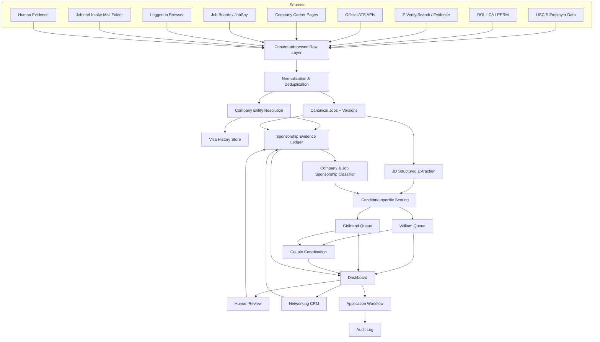

# H-1B Career Intelligence System（HCIS）

## Codex 主执行规格与开发计划

**版本：** 1.0  
**日期：** 2026-08-07  
**项目所有者：** William  
**默认代码库路径：** `/Users/williamniu/AI/projects/h1b-career-intelligence`
**默认运行主机：** 24/7 开机的 MacBook Air  
**默认访问方式：** MacBook Pro 经本地网络或 Tailscale/Headscale 访问  
**交付性质：** 本地优先、双候选人、增量运行、证据驱动、人机协作的求职情报系统

---

# 0. 给 Codex 的执行指令

你是本项目的主开发 Agent。请完整阅读本文件后再开始编码。

本文件中的用户决策已经确认，不要重新发散需求，也不要将其替换成你更偏好的产品方向。遇到未明确的信息时，优先采用安全、可配置、可回滚的默认值，并把未知项写入 `docs/OPEN_QUESTIONS.md`，不要阻塞整个项目。

必须遵守以下总原则：

1. **建立一个全新的本地代码库，而不是直接 Fork 任意一个现有项目。**
2. **先实现可运行的垂直切片，再逐步扩展数据源。**
3. **所有扫描必须默认增量、幂等、可恢复。**
4. **没有公开 H-1B 记录只能表示 `UNKNOWN`，绝不能自动表示“不支持”。**
5. **公司级赞助历史与当前岗位级赞助政策必须分开。**
6. **所有重要判断必须有证据、来源、日期、适用范围和置信度。**
7. **人工审核结论优先，自动任务不得静默覆盖人工结论。**
8. **系统可以研究、排序、生成草稿和预填申请，但不能自动发送消息或点击最终 Submit。**
9. **不要要求或保存模型的隐藏思维链。只保存结构化决策轨迹：输入、证据、规则、工具调用、评分组成和最终结论。**
10. **不要把真实密码、Cookie、浏览器 Profile、简历、邮件、联系人或候选人私密数据提交到 Git。**
11. **不要绕过验证码、MFA、平台风控或反自动化机制。**
12. **不要公开部署，不要 Push 到远程 GitHub，除非用户另行明确批准。**
13. 每个里程碑完成后：
    - 运行测试；
    - 更新 `docs/STATUS.md`；
    - 生成可审计的变更摘要；
    - 创建本地 Git commit；
    - 不自动 Push。
14. 最终必须提供：
    - 可运行代码；
    - 数据迁移；
    - 测试；
    - 运维手册；
    - 隐私与安全说明；
    - 示例报告；
    - `HANDOFF.md`；
    - 本地启动、停止、暂停、恢复和诊断命令。

---

# 1. 项目使命

本系统不是普通 Job Scraper，也不是“历史 Sponsor List 查询器”。

它要实现的是：

> 从全美当前雇主和当前开放岗位出发，持续发现适合两位候选人的机会；同时汇总 USCIS、DOL、E-Verify、当前招聘文本、公司政策、Recruiter/HR/员工回复和人工知识，建立可审计的 H-1B Sponsorship Evidence Graph；再按身份路径、岗位匹配、公司质量、地域、语言负担和双人协调进行分层排序。

系统最终回答的不是单一问题：

```text
“这家公司历史上有没有 H-1B？”
```

而是以下一组问题：

```text
1. 这家公司过去是否有 H-1B Petition、LCA 或 PERM 记录？
2. 这些记录属于 Initial、Continuing、Transfer、Extension 还是无法区分？
3. 当前这个岗位是否明确支持或拒绝 sponsorship？
4. 是否接受 F-1 OPT 入职？
5. 是否满足 STEM OPT 所需的 E-Verify 条件？
6. 是否愿意让员工参加入职或转正后的第一个可用 H-1B 抽签年度？
7. 该政策是公司级、部门级、岗位级还是地点级？
8. 如果公开信息不足，是否值得人工联系 HR、Recruiter、校友或国际员工核实？
9. 对 William 和其女朋友而言，这个岗位分别值不值得申请？
10. 两人是否存在同城或未来汇合的组合机会？
```

---

# 2. 最关键的业务逻辑

## 2.1 “没有公开记录”不等于“不支持 H-1B”

这是系统的第一条不可违反规则。

USCIS H-1B Employer Data Hub 反映的是雇主提交的 H-1B **Petition** 数据。未中签的电子 **Registration** 不会变成正式 Petition，因此可能不出现在 Employer Data Hub 中。

典型情况：

```text
公司愿意为 F-1 员工参加 H-1B Registration
→ 员工没有中签
→ 公司无法提交对应的正式 Petition
→ USCIS Employer Data Hub 没有该年度记录
```

因此以下情况全部必须归类为：

```text
UNKNOWN / NEEDS HUMAN VERIFICATION
```

而不是：

```text
DOES NOT SPONSOR
```

包括：

- USCIS 最近几年没有记录；
- DOL LCA 没有记录；
- PERM 没有记录；
- MyVisaJobs、H1BData 等第三方没有结果；
- 公司官网没有公开移民政策；
- JD 没有写 sponsorship；
- 公司是成立时间较短的 Startup；
- 公司近几年帮助员工抽签但无人中签。

系统必须通过单元测试和集成测试锁死这一语义。

---

## 2.2 雇主发现与 Sponsorship 验证必须分离

不得采用：

```text
历史 Sponsor List
→ 只扫描这些公司的岗位
```

必须采用两条相互独立的发现通道。

### 通道 A：Sponsor-first

```text
USCIS Employer Data
DOL LCA
DOL PERM
第三方签证检索
        ↓
发现已知历史赞助商
        ↓
扫描其当前招聘岗位
```

### 通道 B：Job-first / Company-first

```text
全美当前 AI、产品、咨询、运营、数据、平台和客户类岗位
AI Startup 名录
VC Portfolio
公司 ATS / Career Page
LinkedIn / Indeed / Glassdoor / Simplify
        ↓
发现所有可能相关的公司
        ↓
再验证其 Sponsorship 状态
```

两条通道汇总到同一 Company、Job 和 Evidence 数据模型中。

---

## 2.3 公司级与岗位级判断必须分开

同一家公司可能出现：

```text
公司历史上大量赞助 H-1B
但当前岗位明确写明不提供 sponsorship
```

也可能出现：

```text
公司没有近期官方记录
但当前 HR 明确确认转正后第一年即可参加 H-1B 抽签
```

因此至少保存：

```yaml
company_sponsorship_assessment:
job_sponsorship_assessment:
candidate_specific_eligibility:
```

优先级：

```text
当前岗位明确限制
> 当前部门或地点政策
> 当前公司官方政策
> HR / Recruiter 针对该岗位的确认
> 近期历史官方数据
> 较旧历史官方数据
> 第三方数据库
> 推断性信号
```

人工确认可以覆盖自动分类，但必须保留历史版本和审计日志。

---

## 2.4 系统优化目标

H-1B 当前采用以受益人为中心的选择机制。系统不应假设“让更多雇主为同一个人重复注册就能线性增加抽中概率”。

系统真正要优化的是：

```text
获得合适 Offer 的概率
×
顺利以 CPT / OPT / STEM OPT 工作的概率
×
雇主在第一个可用年度为候选人注册的概率
×
后续年度持续注册的概率
×
中签后成功准备和递交 Petition 的概率
×
候选人能够持续任职到身份稳定的概率
```

---

# 3. 已确认的用户决策

| 维度 | 已确认决策 |
|---|---|
| 候选人数 | 2 人：William 与其女朋友 |
| 数据底层 | 公司、岗位、签证历史、Evidence、数据源、Checkpoint 共享 |
| 个性化层 | Candidate Profile、评分、简历、申请、CRM、报告完全分开 |
| 毕业时间 | 两人均为 2026 年 12 月毕业 |
| 工作授权 | 两人均为 STEM OPT eligible，理论上可使用 12 个月 OPT + 24 个月 STEM OPT |
| 毕业前工作 | 两人均愿意通过合规 CPT 接受实习、长期实习、Co-op、提前入职或 Intern-to-Full-Time |
| H-1B 要求 | 入职或转正后参加第一个可用 H-1B 抽签年度，接近硬性要求 |
| Cap-exempt | 默认排除，不以高校、科研机构和非营利机构为主要候选池 |
| 经验范围 | William：New Grad 至 0–5 年广泛收集；女朋友：0–3 年为主，3–5 年作为冲刺 |
| 地理范围 | 全美开放 |
| 城市优先级 | 纽约 > 芝加哥 > 湾区 > 西雅图 > 波士顿 > 奥斯汀 > 其他全美 |
| 到岗方式 | Onsite、Hybrid、Remote 均接受 |
| 双人地域 | 同城优先，但优质 H-1B 机会允许阶段性异地 |
| 公司阶段 | Pre-seed、Seed、Series A/B/C、Pre-IPO、大型成熟公司都接受 |
| 公司偏好 | William 更偏好 Startup，但不放弃大型成熟公司；女朋友其余偏好保持一致 |
| 目标优先级 | 身份稳定 > 岗位与职业成长 > 公司质量 > 薪酬和地点 |
| 咨询公司 | 保留正规咨询、实施和技术服务公司 |
| 排除公司 | Staffing Agency、Body Shop、第三方派遣、高身份风险外包默认排除 |
| Sponsorship 审核 | 明确信息可自动分类；无记录、含糊、冲突全部交给人工确认 |
| 扫描频率 | 每天 2–4 次 |
| 计算方式 | 增量、幂等、Checkpoint 驱动；不得每次全量重算 |
| 运行位置 | MacBook Air 本地常驻 |
| 手动控制 | 必须支持 Start / Stop / Pause / Resume / Run Once |
| 重启行为 | 自动恢复关机前 desired state |
| 提醒渠道 | Dashboard + 邮件 |
| 浏览器 | Air 专用自动化 Profile + Pro 敏感操作的混合模式 |
| 申请自动化 | 自动研究、材料准备和预填；最终 Submit 前强制人工确认 |
| Networking | 完整联系人 CRM，不自动发送 |
| 邮箱 | 当前工作 Outlook 邮箱 |
| 邮箱隔离 | Outlook 服务器端规则导入 `JobIntel-Intake` 专用文件夹 |
| 邮箱读取 | 严格白名单，只读该文件夹 |
| Microsoft Graph | 第一版不依赖管理员审批；保留未来可插拔适配器 |
| 第一版邮件接入 | Himalaya / IMAP 只读 `JobIntel-Intake` |
| 日历 | 第一版从招聘邮件和 `.ics` 中提取，人工确认 |
| 输出 | William 与女朋友清单、报告、CRM、申请记录严格分开 |

---

# 4. 两位候选人的 Profile

## 4.1 William

### 已知事实

```yaml
candidate_id: william
graduation: 2026-12
stem_opt_eligible: true
cpt_before_graduation: true
current_context:
  - University of Chicago graduate student
  - AI Engineer summer internship in New York
exact_degree_program: to_be_imported_from_resume
```

### 第一梯队岗位

```text
LLM Engineer
AI Agent Engineer
Agentic AI Engineer
Generative AI Engineer
LLM Application Engineer
RAG Engineer
Applied AI Engineer
AI Product Engineer
Applied Machine Learning Engineer
AI Platform Engineer
AI Infrastructure Engineer
ML Platform Engineer
MLOps / LLMOps Engineer
Inference Engineer
Inference Platform Engineer
Distributed AI Systems Engineer
AI Solutions Engineer
Generative AI Solutions Engineer
AI Solutions Architect
AI Implementation Engineer
AI Consultant
Data Science Consultant
Generative AI Consultant
AI Transformation Consultant
Forward Deployed Engineer
Forward Deployed AI Engineer
Forward Deployed Software Engineer
Deployment Engineer
Deployment Strategist
Field AI Engineer
```

### 第二梯队岗位

```text
Machine Learning Engineer，优先 GenAI / LLM / Inference
Software Engineer，优先 AI / Backend / Platform / Distributed Systems
Data Scientist / Applied Scientist，优先产品落地而非纯科研
```

### 行业优先级

```text
1. AI-native / Foundation Model / Agent / AI Applications
2. Cloud / AI Platform / Data Infrastructure / Developer Tools
3. FinTech / Banking / Insurance / Financial Infrastructure
4. Formal Consulting / Digital Transformation / Enterprise AI Services
5. Large Technology / Internet Companies
6. Healthcare / Manufacturing / Energy / Retail / Logistics 等传统行业中的优质 AI 岗位
```

---

## 4.2 Girlfriend

### 已知事实

```yaml
candidate_id: girlfriend
graduation: 2026-12
stem_opt_eligible: true
cpt_before_graduation: true
education:
  institution: Carnegie Mellon University
  program: Information Management / MISM
  exact_official_title: to_be_confirmed_from_resume
experience:
  company: DeepWisdom, Shenzhen
  title: AI Product Manager
  product_type: B2C
  domain:
    - AI Agent
    - Multi-Agent Platform
  detailed_responsibilities: unknown
  quantitative_results: unknown
```

不得自行补写她在 DeepWisdom 的职责、用户规模、增长、模型评测、产品上线或商业化成果。必须从其简历、LinkedIn、项目文件或人工输入中提取。

### Tier 1：最对口岗位

```text
AI Product Manager
Generative AI Product Manager
Product Manager - AI/ML
Technical Product Manager - AI
Product Manager - Data / Platform / SaaS
AI Solutions Product Manager
Product Operations
Product Analyst
Technical Program Manager
Program Manager - AI / Data / Technology
```

### Tier 2：身份路径明确时积极申请

```text
Business Analyst
Business Systems Analyst
Data Analyst
BI Analyst
Operations Analyst
Business Operations / BizOps
Strategy & Operations
Revenue Operations
Sales Operations
Growth Operations
Implementation Consultant
Technology Consultant
Solutions Consultant
Customer Success Manager
Technical Account Manager
Project Manager
Program Manager
Digital Transformation Consultant
Product Strategy
Management Consulting
Financial / Risk / Supply Chain Analytics
Business Development
Enterprise Sales
Sales Engineer
```

### Tier 3：广泛兜底

```text
大型公司的普通 Corporate Operations
Marketing Operations
Commercial Operations
Client Operations
Account Operations
Vendor Operations
其他要求本科或硕士学历、且能够与 Information Management 建立合理专业关联的企业职能岗位
```

### 口语状态

```text
日常英文交流基本可以；
长回答、商业表达、临场讨论、客户沟通和正式演示较困难。
```

不得因此删除高口语岗位。必须分别显示：

```yaml
spoken_english_intensity: 1-5
customer_facing_ratio: low | medium | high
presentation_frequency: rare | monthly | weekly | daily
sales_persuasion_load: low | medium | high
negotiation_load: low | medium | high
unstructured_conversation_load: low | medium | high
prepared_communication_ratio: low | medium | high
current_communication_fit: 0-100
improvement_feasibility: 0-100
```

行动队列：

```text
优先申请：
身份路径强 + 专业关联合理 + 口语负担低到中等

准备后冲刺：
身份路径强 + 机会价值高 + 口语负担较高但可针对性训练

高难度保留：
纯销售、强谈判、高频客户演示等岗位，保留但明显提示风险
```

---

## 4.3 共同约束

```yaml
cap_exempt_default_excluded: true
first_available_h1b_lottery_required: true
location_priority:
  - New York
  - Chicago
  - San Francisco Bay Area
  - Seattle
  - Boston
  - Austin
  - Other US
employer_policy:
  regular_consulting_allowed: true
  staffing_agency_excluded: true
  body_shop_excluded: true
  contract_to_hire_default: high_risk
startup_stage:
  all_stages_allowed: true
automation:
  final_application_submit_requires_human: true
  outbound_message_requires_human: true
```

---

# 5. 开源项目调研结论与复用策略

本项目需要借鉴多个项目的局部设计，但不直接以任何一个项目作为完整底座。

## 5.1 `aryaminus/h1b-job-search-mcp`

**用途：** DOL LCA 数据下载、缓存、搜索、公司统计、MCP 工具。  
**技术：** Python、Pandas、FastMCP。  
**许可证：** MIT。

### 可借鉴

- 官方 DOL 数据下载与缓存；
- 按岗位、地点、工资筛选；
- 将签证查询封装为工具；
- CSV 导出；
- MCP 接口思想。

### 不足

- 只有历史 LCA；
- 不是实时职位系统；
- 无 Evidence Ledger；
- 无公司实体解析；
- 无首次抽签与 Transfer 区分；
- 无“零记录公司”发现；
- 核心逻辑集中在单文件，不宜直接扩展。

**结论：** 可参考或复用 MIT 兼容的小型数据下载逻辑，但应重构到本项目 Source Adapter 架构中。

---

## 5.2 `speedyapply/JobSpy`

**用途：** 聚合 LinkedIn、Indeed、Glassdoor、Google、ZipRecruiter 等职位。  
**技术：** Python。  
**许可证：** MIT。

### 可借鉴

- 多平台适配器；
- 统一 JobPost Schema；
- 时间、地点、远程和关键词过滤；
- 作为补漏工具。

### 风险

- LinkedIn 等平台限流严格；
- 可能出现 429、封锁、重复和过期；
- 聚合结果不如官方 ATS 稳定；
- 不理解 Sponsorship。

**结论：** 作为可选 Fallback，不作为核心数据源。官方 ATS API 和公司 Career Page 优先。

---

## 5.3 `Big-Data-IA-Team-5/job-intelligence-platform`

**用途：** 端到端职位情报、抓取、DBT、H-1B Join、Embedding、Dashboard。  
**技术：** Airflow、DBT、Snowflake、S3、GCP、FastAPI、Streamlit。

### 可借鉴

- Raw → Staging → Processing → Mart 数据分层；
- 调度、重试、超时、日志；
- 抓取与分析解耦；
- Resume Match 与 Analytics 作为下游模块。

### 不应照搬

- GCP + AWS + Snowflake 对个人系统严重过度设计；
- H-1B 仍然只是历史 Join；
- 无 Evidence Ledger；
- 无 Zero-Record Discovery；
- 运维成本高。

**结论：** 借鉴数据分层和运维思想，基础设施改成本地 PostgreSQL + DuckDB + Parquet + Docker Compose。

---

## 5.4 `Sat-ish77/JobHunt_int`

**用途：** 面向 F-1/OPT 国际学生的职位搜索、H-1B 历史、简历优化、Career Coach。  
**技术：** Streamlit、Supabase、OpenAI、Tavily、Greenhouse、Lever、JSearch。  
**许可证：** Apache-2.0。

### 可借鉴

- 国际学生产品流程；
- Candidate Profile；
- Greenhouse / Lever 聚合；
- Resume Agent 与 Career Coach 分离；
- Streamlit MVP。

### 必须重写

该项目存在不适用于本系统的判断：

1. JD 中只要出现 `sponsor`、`visa`、`OPT` 等关键词就可能被误判为正面；
2. 查不到公司历史时直接返回 `False`；
3. 公司名称使用部分字符串匹配，容易误合并；
4. 无证据作用域和人工复核机制。

**结论：** 只借鉴产品和模块边界，不采用其 Sponsorship Checker。

---

## 5.5 `SimplifyJobs/New-Grad-Positions`

**用途：** 每日维护 New Grad 职位，包含部分“不提供 sponsorship”标记。

### 可借鉴

- New Grad Seed Feed；
- 岗位年龄；
- AI/ML 分类；
- Citizenship / No Sponsorship 提示。

### 风险

- 主要覆盖 New Grad；
- Sponsorship 标记较粗；
- 数据在 README/HTML 中；
- 未确认可复用许可证。

**结论：** 仅作为外部 Seed Source，保存原始链接和证据，不复制其代码或大规模再分发其数据。

---

## 5.6 `feder-cr/Jobs_Applier_AI_Agent_AIHawk`

**用途：** 自动申请、Profile、浏览器自动化。  
**许可证：** AGPL-3.0。

### 可借鉴

- Application State Machine；
- 常见表单答案；
- 简历版本管理；
- 浏览器任务设计。

### 不应采用

- 不复制 AGPL 代码进入本项目；
- 不做无监督批量申请；
- 不自动 Submit；
- 不绕过平台风控。

**结论：** 仅研究交互和状态设计。

---

## 5.7 `RutviShah1107/H1B-Sniper`

**用途：** 多年 DOL 数据清洗、关系型数据库、Flask 查询。

### 可借鉴

- 历史大文件 ETL；
- 关系模型；
- Employer / Job / Wage 分表。

### 风险

- 项目较旧；
- 无许可证；
- 无实时职位和 Evidence。

**结论：** 只参考数据建模思想，不复制代码。

---

## 5.8 最终架构选择

```text
JobHunt_int 的国际学生产品思路
+
job-intelligence-platform 的数据分层
+
h1b-job-search-mcp 的官方数据适配思想
+
JobSpy 的可选职位补漏
+
全新实现的：
  Company Entity Resolution
  Sponsorship Evidence Ledger
  Zero-Public-Record Discovery Lane
  Human Verification Queue
  Multi-Candidate Scoring
  Incremental / Idempotent Runtime
```

---

# 6. 推荐技术栈

| 层级 | 技术 |
|---|---|
| 语言 | Python 3.12 |
| 包管理 | `uv` |
| 类型与 Schema | Pydantic v2 |
| API | FastAPI |
| 主数据库 | PostgreSQL |
| 向量 | pgvector |
| 大型官方数据分析 | DuckDB + Parquet |
| DataFrame / ETL | Polars，必要时 Pandas |
| ORM | SQLAlchemy 2 |
| 数据迁移 | Alembic |
| 调度编排 | Prefect，固定到经测试的稳定版本 |
| HTTP | HTTPX |
| HTML | BeautifulSoup / selectolax |
| 动态页面 | Playwright，通过专用 Chrome Profile / CDP |
| Dashboard | Streamlit 第一版 |
| LLM | Provider Adapter，支持 OpenAI-compatible、Ollama |
| 测试 | Pytest、pytest-asyncio |
| 代码质量 | Ruff、Mypy |
| 日志 | Structlog 或标准 JSON Logging |
| 容器 | Docker Compose |
| macOS 启动恢复 | `launchd` Supervisor |
| 报告 | Markdown、CSV、JSON |
| 邮箱 | Himalaya / IMAP Folder Adapter |
| 备份 | `pg_dump` + 配置与 Parquet 快照 |

注意：

- Prefect 只负责调度、重试和任务可视化；
- **业务幂等性必须由数据库唯一约束、Checkpoint、Hash 和 Upsert 保证，不能依赖 Prefect 是否只执行一次。**
- 第一版不使用 Snowflake、Airflow、AWS、GCP 或外部托管向量数据库。

---

# 7. 高层架构



---

# 8. 数据源与 Source Adapter

所有数据源实现统一接口。

```python
class SourceAdapter(Protocol):
    source_id: str

    async def discover(self, checkpoint: SourceCheckpoint) -> DiscoveryBatch: ...
    async def fetch(self, item: DiscoveredItem) -> RawArtifact: ...
    async def normalize(self, artifact: RawArtifact) -> list[NormalizedRecord]: ...
    async def health_check(self) -> SourceHealth: ...
```

必须支持：

```yaml
source_id:
source_type:
enabled:
schedule:
rate_limit:
checkpoint_strategy:
credential_scope:
data_classification:
terms_notes:
last_success_at:
last_failure_at:
```

---

## 8.1 官方签证数据

### USCIS Employer Data Hub

提取：

```text
Fiscal Year
Employer / Petitioner Name
Tax ID 后四位（若公开字段存在）
NAICS
Initial Approval
Initial Denial
Continuing Approval
Continuing Denial
City / State / ZIP
```

处理要求：

- 不硬编码单个年度；
- 维护 Source Manifest；
- 下载后保存原始文件 Hash；
- 转换为 Parquet；
- 按年度和雇主实体聚合；
- 保留原始记录；
- 计算 Initial / Continuing 趋势和通过率；
- 不把零记录作为负面证据；
- 不把 Continuing 自动解释为首次抽签；
- 不把 Initial Approval 解释为 Registration 总数。

### DOL OFLC LCA

当前官方页面提供 FY2026 Q2 及历史 LCA / PERM 文件。适配器必须自动解析最新 Manifest，而不是把 `FY2026_Q2` 写死。

提取：

```text
CASE_NUMBER
CASE_STATUS
RECEIVED_DATE
DECISION_DATE
VISA_CLASS
EMPLOYER_NAME
EMPLOYER_ADDRESS
EMPLOYER_CITY / STATE / POSTAL
NAICS_CODE
JOB_TITLE
SOC_CODE / SOC_TITLE
FULL_TIME_POSITION
BEGIN_DATE / END_DATE
WAGE_RATE
WAGE_UNIT
PREVAILING_WAGE
WAGE_LEVEL
WORKSITE
H-1B_DEPENDENT
WILLFUL_VIOLATOR
```

使用方式：

- 作为公司过去准备或办理 H-1B 的强信号；
- 匹配相似岗位、地点、SOC 和工资；
- 不作为全部电子 Registration 的完整记录；
- 区分 Certified、Denied、Withdrawn 等状态；
- 优先保留 Certified，但不删除其他状态。

### DOL PERM

用途：

- 长期移民支持；
- Immigration Counsel 成熟度；
- 公司是否愿意承担更长期流程。

不得单独据此判定当前岗位支持首次 H-1B。

### E-Verify

需要单独保存：

```yaml
stem_opt_eligibility_signal:
  value: confirmed | likely | unknown | no
  evidence_scope: company | hiring_site | location
```

E-Verify 是 STEM OPT 的重要条件，但不等于 H-1B sponsorship。

如无稳定公开 API：

- 通过官方 Employer Search Tool 的低频查询；
- 使用浏览器任务；
- 支持人工导入；
- 缓存查询结果；
- 记录查询日期和适用 Hiring Site；
- 不用第三方结果作为唯一依据。

---

## 8.2 第三方签证检索

可配置接入：

```text
MyVisaJobs
H1BData.info
Levels.fyi H-1B
F1 Hire / FrogHire 等浏览器工具
```

定位：

```text
快速检索和交叉验证
≠
官方事实源
```

必须：

- 保存原始 URL；
- 保存检索日期；
- 标记 `source_authority=secondary`；
- 不覆盖 USCIS / DOL；
- 不以“无搜索结果”生成负面证据。

---

## 8.3 当前职位数据源优先级

```text
1. 公司官方 ATS 公共 API
2. 公司官方 Career Page
3. 结构化公开招聘 Feed
4. Curated New Grad Feed
5. JobSpy / Search Engine 补漏
6. 登录态浏览器补充
```

### Greenhouse

使用官方 Job Board GET API：

```text
GET /v1/boards/{board_token}/jobs?content=true
GET /v1/boards/{board_token}/jobs/{job_id}
```

公开 GET 不需要认证。

### Lever

使用公开 Postings API：

```text
GET /v0/postings/{site}?mode=json
GET /v0/postings/{site}/{posting_id}?mode=json
```

只读取 published postings。

### Ashby

使用公开 Job Postings API：

```text
GET https://api.ashbyhq.com/posting-api/job-board/{JOB_BOARD_NAME}
```

### SmartRecruiters

优先使用其公开 Posting API；如某公司配置需要 API Key，则降级到官方 Career Page。

### Workday

Workday 没有统一的全平台公开接口。实现：

- `WorkdayAdapter`，按租户配置；
- 解析公开 Candidate Site；
- 记录 tenant、site、locale；
- 对不同租户使用独立 Checkpoint；
- 页面结构变化时失败可见，不静默返回空集。

### 公司 Career Page

建立：

```text
Company
→ Career URL
→ ATS Provider
→ ATS Token / Site ID
→ Last Successful Scan
```

不得假设 Greenhouse 存在一个公开“全公司目录”。

### Simplify New Grad

作为 Seed Feed：

- 发现应届岗位；
- 保存原始申请 URL；
- 对 `No Sponsorship`、Citizenship、Closed 等标记进行二次验证；
- 不复制未授权代码或完整数据库。

### JobSpy

仅在：

- 官方 ATS 未覆盖；
- 公司 Career Page 难以解析；
- 需要补漏；

时启用。默认限速，设置来源标签，结果必须跳转官方页面验证。

---

## 8.4 Startup 与 Zero-Record Company Discovery

需要维护独立的 Startup Watchlist。

来源可包括：

```text
AI Startup 名录
YC / Accelerator Jobs
VC Portfolio Career Pages
GitHub Trending AI Companies
AI Conference / Demo Day Company Lists
LinkedIn Company / Jobs Search
Wellfound 等登录态招聘页面
用户手工添加公司
```

每家 Startup 至少保存：

```yaml
funding_stage:
funding_evidence:
last_funding_date:
headcount_signal:
us_legal_entity_signal:
us_payroll_signal:
everify_signal:
immigration_counsel_signal:
career_page:
ats_provider:
confidence:
```

缺失信息保持 `unknown`，不得由 LLM编造。

---

# 9. 核心数据库模型

使用 UUID 主键；所有表包含：

```text
created_at
updated_at
source_provenance
```

重要表如下。

---

## 9.1 Candidate

### `candidates`

```text
id
slug
display_name
graduation_date
stem_opt_eligible
cpt_available
first_available_lottery_required
active
profile_version
```

### `candidate_documents`

```text
id
candidate_id
document_type
file_path
content_hash
parsed_text_path
source
version
review_status
```

### `candidate_experiences`

```text
id
candidate_id
company
title
start_date
end_date
description
evidence_document_id
verification_status
```

### `candidate_skills`

```text
id
candidate_id
skill
skill_category
evidence_type
proficiency_claim
evidence_document_id
human_confirmed
```

### `candidate_preferences`

```text
candidate_id
preference_key
value_json
version
```

---

## 9.2 Company

### `companies`

```text
id
canonical_name
brand_name
official_domain
career_domain
company_type
industry
naics_primary
startup_stage
headquarters
active
```

### `company_aliases`

```text
id
company_id
alias
alias_type
source
confidence
human_confirmed
UNIQUE(normalized_alias, company_id)
```

### `company_relationships`

```text
parent_company_id
child_company_id
relationship_type
source
confidence
human_confirmed
```

### `company_source_identifiers`

```text
company_id
source
external_id
identifier_type
UNIQUE(source, external_id)
```

---

## 9.3 Source 与 Raw Layer

### `source_registry`

```text
id
source_key
source_type
enabled
config_json
authority_level
data_classification
```

### `source_checkpoints`

```text
source_id
partition_key
cursor
watermark
etag
last_modified
last_success_at
last_attempt_at
state_json
UNIQUE(source_id, partition_key)
```

### `raw_artifacts`

```text
id
source_id
source_uri
external_id
retrieved_at
http_status
content_type
content_hash
storage_path
metadata_json
UNIQUE(source_id, source_uri, content_hash)
```

所有 Raw 文件使用内容寻址路径：

```text
data/raw/{source}/{yyyy}/{mm}/{sha256}.{ext}
```

---

## 9.4 Job

### `jobs`

```text
id
company_id
canonical_title
normalized_title
location_text
city
state
country
workplace_type
employment_type
experience_min
experience_max
posted_at
first_seen_at
last_seen_at
closed_at
current_status
canonical_url
```

### `job_sources`

```text
job_id
source_id
external_job_id
source_url
last_seen_at
content_hash
UNIQUE(source_id, external_job_id)
```

当无 external ID 时使用确定性 Fingerprint：

```text
sha256(
  company_domain
  + normalized_title
  + normalized_location
  + normalized_url_path
)
```

### `job_versions`

```text
id
job_id
version_number
content_hash
title
description
requirements_json
compensation_json
source_artifact_id
valid_from
valid_to
UNIQUE(job_id, content_hash)
```

无变化不得新增版本。

### `job_role_labels`

```text
job_id
role_family
role_subfamily
label_source
confidence
algorithm_version
```

---

## 9.5 Visa History

### `uscis_employer_metrics`

```text
id
company_id
legal_employer_name
fiscal_year
tax_id_last4
naics
initial_approval
initial_denial
continuing_approval
continuing_denial
source_artifact_id
```

### `lca_cases`

保存原始 Case 粒度及规范化字段。

### `perm_cases`

保存原始 Case 粒度及规范化字段。

### `everify_evidence`

```text
company_id
hiring_site
status
source
verified_at
evidence_artifact_id
confidence
```

---

## 9.6 Sponsorship Evidence Ledger

### `sponsorship_evidence`

```text
id
company_id
job_id NULL
candidate_id NULL
evidence_type
source_type
source_uri
source_artifact_id
scope_type
scope_department
scope_location
polarity
first_time_h1b
first_available_lottery
h1b_transfer
opt_supported
stem_opt_supported
everify_status
current_sponsorship
future_sponsorship
verbatim_excerpt
effective_date
retrieved_at
expires_at
authority_level
confidence
human_review_status
content_hash
```

唯一键：

```text
sha256(
  company_id
  + coalesce(job_id)
  + source_uri
  + evidence_type
  + normalized_excerpt
  + effective_date
)
```

### `coverage_observations`

用于记录：

```text
“查询过某数据源但没有结果”
```

而不是生成负面 Evidence。

```text
company_id
source_id
query
query_time
result_count
coverage_period
notes
```

---

## 9.7 Assessment 与人工审核

### `sponsorship_assessments`

```text
id
company_id
job_id NULL
candidate_id NULL
classification
sponsorship_strength
evidence_confidence
first_available_lottery_status
everify_status
reason_codes_json
evidence_ids_json
algorithm_version
generated_at
superseded_at
```

### `human_reviews`

```text
id
review_type
company_id
job_id
candidate_id
reviewer
decision
notes
evidence_ids
reviewed_at
recheck_after
is_current
```

自动任务不得覆盖当前 `human_reviews`。发现新冲突证据时，只能：

```text
创建 needs_re_review 任务
```

---

## 9.8 Candidate Scoring

### `candidate_job_scores`

```text
candidate_id
job_id
candidate_profile_version
scoring_algorithm_version
action_lane
identity_path_score
role_fit_score
experience_feasibility_score
degree_role_relation_score
communication_load_score
communication_fit_score
company_quality_score
startup_growth_score
company_survival_score
location_score
compensation_score
verification_value_score
overall_score
score_components_json
generated_at
UNIQUE(candidate_id, job_id, candidate_profile_version, scoring_algorithm_version)
```

---

## 9.9 CRM

### `contacts`

```text
id
canonical_profile_url
name
company_id
title
location
email
contact_type
source
last_verified_at
UNIQUE(canonical_profile_url)
```

### `candidate_contact_relationships`

```text
candidate_id
contact_id
relationship_strength
shared_background_json
priority
pipeline_stage
last_interaction_at
next_follow_up_at
notes
UNIQUE(candidate_id, contact_id)
```

### `contact_job_links`

```text
contact_id
job_id
relationship_to_job
confidence
```

### `crm_events`

```text
id
candidate_id
contact_id
job_id
event_type
event_time
source
external_event_id
content_hash
notes
UNIQUE(source, external_event_id)
```

---

## 9.10 Application

### `applications`

```text
id
candidate_id
job_id
status
resume_version
cover_letter_version
referrer_contact_id
applied_at
last_status_change
notes
UNIQUE(candidate_id, job_id)
```

状态：

```text
DISCOVERED
SHORTLISTED
VERIFYING_SPONSORSHIP
MATERIALS_PREPARING
READY_FOR_REVIEW
PREFILL_READY
USER_REVIEWING
SUBMITTED
OA
PHONE_SCREEN
INTERVIEWING
OFFER
REJECTED
WITHDRAWN
CLOSED
```

---

## 9.11 Browser、Mail、Notification、Runtime

### `browser_tasks`

```text
id
candidate_id
job_id
contact_id
task_type
target_url
risk_level
recommended_action
status
created_at
completed_at
result_json
```

### `mail_messages`

```text
account_id
folder
uidvalidity
uid
internet_message_id
thread_key
subject
sender
received_at
content_hash
whitelist_match
body_storage_path
UNIQUE(account_id, folder, uidvalidity, uid)
```

### `notifications_outbox`

```text
id
candidate_id
channel
event_key
payload_json
status
attempt_count
sent_at
UNIQUE(channel, event_key)
```

### `llm_cache`

```text
provider
model
prompt_name
prompt_version
input_hash
output_json
created_at
UNIQUE(provider, model, prompt_name, prompt_version, input_hash)
```

### `job_runs`

```text
id
flow_name
idempotency_key
scheduled_for
started_at
finished_at
status
inserted_count
updated_count
skipped_count
closed_count
failed_count
llm_calls
tokens_in
tokens_out
error_summary
UNIQUE(flow_name, idempotency_key)
```

### `system_state`

```text
key
value_json
updated_at
updated_by
```

必须包含：

```yaml
desired_state: STOPPED | PAUSED | SCHEDULED
```

---

# 10. Company Entity Resolution

不得仅使用部分字符串 `contains()` 完成公司合并。

## 10.1 确定性匹配优先级

```text
1. 官方 Domain 完全匹配
2. ATS Token / Site ID 完全匹配
3. 已人工确认 Alias
4. 官方法律实体名称完全匹配
5. EIN / Tax ID 后四位 + 地址 + NAICS 组合
6. 公司地址与官方网站联合匹配
7. Fuzzy Match 候选
```

Fuzzy Match 只生成候选：

```text
POSSIBLE_MATCH
```

不得自动合并。

## 10.2 母子公司

需要支持：

```text
Amazon
├── Amazon.com Services LLC
├── Amazon Web Services Inc.
└── 其他法律实体
```

展示时可聚合集团趋势，但 Evidence 必须保留具体法律实体。

不得将母公司的 H-1B 历史无条件传递给所有子公司或当前岗位。

---

# 11. Sponsorship Evidence 分类体系

## 11.1 Evidence Type

```text
USCIS_INITIAL_APPROVAL
USCIS_INITIAL_DENIAL
USCIS_CONTINUING_APPROVAL
USCIS_CONTINUING_DENIAL
DOL_LCA_CERTIFIED
DOL_LCA_DENIED
DOL_LCA_WITHDRAWN
DOL_PERM_CERTIFIED
EVERIFY_CONFIRMED
CURRENT_JOB_POSITIVE
CURRENT_JOB_NEGATIVE
CURRENT_JOB_TRANSFER_ONLY
COMPANY_POLICY_POSITIVE
COMPANY_POLICY_NEGATIVE
APPLICATION_FORM_QUESTION
RECRUITER_CONFIRMATION
HR_CONFIRMATION
EMPLOYEE_CONFIRMATION
IMMIGRATION_COUNSEL_CONFIRMATION
CANDIDATE_PERSONAL_KNOWLEDGE
THIRD_PARTY_DATABASE
MANUAL_DOCUMENT
```

## 11.2 不属于负面证据的内容

```text
NO_USCIS_RESULT
NO_LCA_RESULT
NO_PERM_RESULT
NO_THIRD_PARTY_RESULT
JOB_DESCRIPTION_SILENT
```

这些只能存入 `coverage_observations`。

---

## 11.3 Assessment 分类

```text
CONFIRMED_FIRST_AVAILABLE_LOTTERY
CONFIRMED_FIRST_TIME_H1B
LIKELY_FIRST_TIME_H1B
UNVERIFIED_HIGH_POTENTIAL
UNKNOWN_NEEDS_VERIFICATION
TRANSFER_ONLY_OR_UNCLEAR
DELAYED_SPONSORSHIP
CONFIRMED_NO_SPONSORSHIP
STALE_OR_CONFLICTING
```

### 自动分类规则

#### `CONFIRMED_FIRST_AVAILABLE_LOTTERY`

需要当前、明确、可追溯证据：

```text
公司 / HR / Recruiter / 律师 / 岗位政策明确支持：
F-1 OPT 或 STEM OPT 员工在入职或转正后的第一个可用 cap-subject H-1B 年度参加 Registration。
```

#### `CONFIRMED_FIRST_TIME_H1B`

明确支持首次 H-1B，但未明确是否第一个可用年度。

#### `LIKELY_FIRST_TIME_H1B`

```text
近期 Initial H-1B 记录
+
相似岗位 / 地点的 Certified LCA
+
无当前负面证据
```

不得写成 Confirmed。

#### `UNVERIFIED_HIGH_POTENTIAL`

```text
岗位高度匹配
+
公司有雇佣和办理能力的正向信号
+
公开记录不足
+
无明确负面证据
```

Startup 和“支持抽签但近期无人中签”的公司应保留在此类别。

#### `UNKNOWN_NEEDS_VERIFICATION`

公开证据不足，尚无足够公司能力或岗位信号。

#### `TRANSFER_ONLY_OR_UNCLEAR`

只有 Continuing / Transfer 或明确“already holds H-1B”信号，无法证明支持首次抽签。

#### `DELAYED_SPONSORSHIP`

明确要求工作满一年或更久，或者错过第一个可用抽签年度。两位候选人均显著降权。

#### `CONFIRMED_NO_SPONSORSHIP`

只能由明确负面证据触发，例如：

```text
We do not sponsor visas.
We are unable to provide sponsorship now or in the future.
Candidates must not require current or future sponsorship.
This role is not eligible for immigration sponsorship.
```

必须保存原文、日期、岗位和适用范围。

#### `STALE_OR_CONFLICTING`

历史支持与当前限制冲突，或者证据过期。

---

# 12. JD Sponsorship 文本抽取

不得使用简单关键词存在性判断。

## 12.1 三阶段解析

### 阶段一：确定性规则

先检测否定、Transfer-only、Citizenship、Clearance。

高优先级负面短语：

```text
does not sponsor
will not sponsor
unable to sponsor
no visa sponsorship
not eligible for sponsorship
must not require sponsorship now or in the future
must be authorized without current or future sponsorship
U.S. citizenship required
security clearance required
```

Transfer-only：

```text
H-1B transfer may be considered
must already hold H-1B status
existing H-1B holders only
```

正面：

```text
visa sponsorship available
H-1B sponsorship offered
we sponsor OPT / STEM OPT employees
eligible for future H-1B sponsorship
```

### 阶段二：LLM 结构化抽取

必须使用 JSON Schema：

```json
{
  "current_work_authorization_required": "yes|no|unknown",
  "future_sponsorship": "yes|no|unknown",
  "first_time_h1b": "yes|no|unknown",
  "first_available_lottery": "yes|no|unknown",
  "h1b_transfer": "yes|no|unknown",
  "opt_supported": "yes|no|unknown",
  "stem_opt_supported": "yes|no|unknown",
  "everify_mentioned": "yes|no|unknown",
  "citizenship_required": "yes|no|unknown",
  "security_clearance_required": "yes|no|unknown",
  "evidence_quotes": [],
  "confidence": 0.0
}
```

### 阶段三：冲突检测

当规则与 LLM 不一致时：

```text
CONFLICTING
→ Human Review
```

模型不得凭常识填补 JD 未写的信息。

---

# 13. Role Taxonomy 与搜索矩阵

Role Taxonomy 由配置文件管理：

```text
config/roles/william.yaml
config/roles/girlfriend.yaml
```

每个 Role Family 包含：

```yaml
canonical_name:
priority_tier:
positive_titles:
positive_description_terms:
required_terms:
negative_titles:
excluded_domains:
experience_range:
communication_defaults:
```

搜索矩阵：

```text
Candidate
× Role Family
× Location
× Experience Window
× Source
```

必须持久化已执行 Query Fingerprint，避免同一轮重复搜索。

---

# 14. 排序体系

单一总分不能取代行动分层。

## 14.1 先进行 Hard Gate

默认排除：

```text
CONFIRMED_NO_SPONSORSHIP
U.S. Citizenship Required 且无法满足
无法取得的 Security Clearance
Cap-exempt-only
Body Shop / 高风险 Staffing
岗位已关闭
明显虚假或重复岗位
```

可以由人工 Override，但必须记录原因。

---

## 14.2 Action Lane

### `P0_APPLY_NOW`

```text
Sponsorship 确认或高度可信
+
岗位匹配高
+
当前开放且新鲜
```

### `P1_APPLY_AND_VERIFY`

```text
岗位高度匹配
+
Sponsorship 为 Likely 或 Unknown
+
无负面证据
```

### `P2_VERIFY_FIRST`

```text
岗位中高匹配
+
公司 / Startup 潜力高
+
Sponsorship 证据不足
```

### `P3_STRETCH`

```text
经验、技能、口语或职责存在明显差距
+
身份机会或公司价值足够高
```

### `HOLD`

证据冲突、岗位即将关闭、等待人工信息。

### `REJECT`

明确不符合硬门槛。

---

## 14.3 William 默认权重

```yaml
identity_path_score: 45
role_fit_score: 25
company_and_growth_score: 15
experience_feasibility_score: 7
location_score: 5
compensation_score: 3
```

## 14.4 Girlfriend 默认权重

```yaml
identity_path_score: 45
degree_role_relation_score: 15
offer_feasibility_score: 15
role_preference_score: 8
communication_fit_score: 7
company_quality_score: 5
location_score: 3
compensation_score: 2
```

权重可在 Dashboard 中修改，修改后生成新的 `scoring_algorithm_version`，不覆盖历史评分。

---

## 14.5 Identity Path Score

建议组成：

```yaml
first_available_lottery: 30
first_time_h1b_evidence: 20
opt_acceptance: 10
stem_opt_and_everify: 15
immigration_process_readiness: 10
employer_stability: 10
evidence_recency: 5
```

Unknown 不得等于零。

示例：

```text
Confirmed first available lottery: 100
Confirmed first-time, timing unknown: 85
Likely based on strong history: 70
Unknown, no negative: 45–60
Delayed: 15–35
Transfer-only: 5–20
Confirmed no: 0
```

高匹配但 Unknown 的岗位通过 `verification_value_score` 保证不会沉底。

---

# 15. 双人地域协调

分别生成两人的个人排名后，再生成组合报告。

```text
SAME_METRO
COMMUTABLE
TEMPORARY_LONG_DISTANCE
FUTURE_REUNIFICATION_PATH
```

组合分数不能覆盖身份路径：

```yaml
couple_coordination_bonus_max: 5
```

输出：

```text
William 最优清单
Girlfriend 最优清单
双人同城组合
双人身份最稳组合
双人职业发展最优组合
阶段性异地高价值组合
```

---

# 16. 幂等性与增量扫描

这是第一版验收条件，不是后期优化。

## 16.1 基本流程

```text
读取 source checkpoint
→ 发现新增或发生变化的条目
→ 下载 / 读取 Raw Artifact
→ 计算 Hash
→ 无变化则 Skip
→ 有变化则 Normalize
→ Upsert Canonical Record
→ 仅对变化内容运行抽取和 LLM
→ 保存新 Checkpoint
```

## 16.2 必须实现

### 稳定唯一键

- ATS：`source + external_job_id`
- 邮件：`account + folder + UIDVALIDITY + UID`
- LCA：Case Number
- USCIS：年度 + 法律实体 + Tax ID + 地址等组合
- Evidence：确定性 Evidence Hash
- Notification：Event Key
- LLM：Prompt Version + Input Hash + Model

### 内容 Hash

```text
职位描述不变
→ 不新增 Version
→ 不重新抽取
→ 不调用 LLM
→ 不重复通知
```

### Checkpoint

每个数据源和分区独立保存：

```text
Cursor
Watermark
ETag
Last-Modified
Last Successful Timestamp
Source-specific State
```

### Upsert

数据库写入使用：

```text
INSERT ... ON CONFLICT DO UPDATE
```

更新前比较内容 Hash，避免无意义写入。

### 并发锁

- PostgreSQL Advisory Lock；
- 或 Prefect Concurrency Limit；
- 两者结合；
- 同一 Source Partition 不得同时运行两次。

### 软删除

职位消失：

```text
第一次未发现 → missing_count + 1
连续多轮未发现或官方页面 404 → CLOSED
```

不物理删除历史。

### 人工结论保护

人工 Review 只可由新的人工 Review 替换。自动流程只能：

```text
标记新证据冲突
创建 re-review 任务
```

### LLM Cache

相同：

```text
Input Hash
Prompt Version
Model
Schema Version
```

直接复用。

### Notification Outbox

先写数据库，再发送。发送成功后标记 `sent`。重试不得重复发。

---

## 16.3 连续两次无变化扫描的验收结果

```text
新增岗位 = 0
新增 Evidence = 0
新增 Job Version = 0
重复记录 = 0
非必要 LLM 调用 = 0
重复邮件 = 0
人工审核被覆盖 = 0
```

## 16.4 Reconciliation

允许低频枚举完整源列表，但仍然：

```text
只对 Hash 变化的记录重新处理
```

推荐：

```text
日常：每天 2–4 次增量
每周：来源完整性对账
每月：实体匹配与历史聚合审计
```

所有低频任务可手动关闭。

---

# 17. 浏览器自动化

## 17.1 MacBook Air

使用独立 Chrome Profile：

```text
~/Library/Application Support/HCIS-Chrome
```

用途：

- LinkedIn / Indeed / Glassdoor / Simplify 职位发现；
- 公司页和员工页研究；
- 登录后职位详情；
- Workday 等申请页面预加载；
- 只读和低风险自动化；
- 生成 Browser Task。

## 17.2 MacBook Pro

处理：

- MFA；
- 验证码；
- 登录恢复；
- LinkedIn 消息；
- Recruiter 回复；
- Sponsorship 人工核实；
- 敏感申请问题；
- 最终 Submit；
- 会议邀请和外部写操作。

## 17.3 硬性边界

不得自动：

```text
发送 LinkedIn 消息
发送 InMail
发送连接邀请
回复 Recruiter
修改 LinkedIn Profile
接受会议
点击最终 Submit
绕过验证码 / MFA / 反自动化
```

## 17.4 Browser Task Queue

```yaml
task_type:
candidate_id:
job_id:
contact_id:
target_url:
risk_level:
reason:
recommended_action:
status:
```

Pro 离线时任务保持 `WAITING_FOR_HUMAN`。

---

# 18. 工作邮箱与日历

## 18.1 Outlook 服务器端规则

创建文件夹：

```text
JobIntel-Intake
```

服务器端规则将以下邮件移入：

```text
Recruiter / Recruiting / Talent Acquisition
Hiring / Job Opportunity / Interview
Referral / Introduction / Networking
HR / Immigration / Visa
H-1B / OPT / STEM OPT / CPT
相关会议、跟进、感谢信
人工指定联系人和线程
```

## 18.2 第一版 Provider

```text
HimalayaFolderProvider
ManualImportProvider
```

未来可插拔：

```text
MicrosoftGraphProvider
```

但第一版不得依赖公司管理员批准。

## 18.3 权限边界

```yaml
include_folders:
  - JobIntel-Intake
exclude_all_other_folders: true
read: true
send: false
delete: false
move: false
mark_read: false
```

## 18.4 增量同步

```text
UIDVALIDITY
Last Seen UID
Message-ID
Thread Key
Content Hash
```

内容未变时不重复解析。

## 18.5 数据隔离

- 普通工作邮件不进入系统；
- 不转发到个人邮箱；
- 不将整个邮箱交给 LLM；
- 不符合白名单的邮件不保存正文；
- 附件默认不下载；
- HR、Recruiter、律师的明确回复可进入 Evidence Ledger；
- 工作邮箱内容默认只能使用本地模型处理，除非用户显式允许外部模型。

## 18.6 Calendar 降级方案

从邮件与 `.ics` 提取：

```text
面试时间
时区
Teams / Zoom / Meet
取消 / 改期
可选时间
```

在 Dashboard 生成待确认事件，不自动写入日历。

## 18.7 Candidate Scope

第一版已确认接入 William 的工作邮箱。

Girlfriend 的 Mail Provider 保持：

```text
disabled / unconfigured
```

直到用户另行配置其邮箱或手工导入，不得假设她的邮件存在于 William 的工作邮箱。

---

# 19. Networking / Referral CRM

## 19.1 联系人发现优先级

```text
1. Hiring Manager
2. Role-specific Recruiter
3. Target Team Employee
4. UChicago / CMU Alumni
5. 国际员工或相似背景员工
6. 二度关系
7. 能提供面试和团队信息的人
```

## 19.2 CRM Pipeline

```text
DISCOVERED
RESEARCHED
READY_TO_CONTACT
DRAFT_PREPARED
USER_APPROVED
CONTACTED
REPLIED
MEETING_SCHEDULED
REFERRAL_REQUESTED
REFERRED
INTERVIEWING
CLOSED
```

## 19.3 Sponsorship 验证问题模板

系统应生成精确问题：

```text
Does the company support first-time, cap-subject H-1B registration
for F-1 OPT or STEM OPT employees during their first eligible lottery season,
or does it only support candidates who already hold H-1B status and need a transfer?
```

继续追问：

```text
是否转正后立即支持？
是否需要工作满一定时间？
是否连续支持后续年度？
是否只适用于特定岗位、地点或职级？
是否参加 E-Verify？
由谁承担律师和申请费用？
```

## 19.4 外部沟通

系统只生成草稿，不自动发送。

---

# 20. Candidate Profile 构建

使用多源合并：

```text
Master Resume
LinkedIn
GitHub
项目 README
技术文档
教育与课程
实习经历
人工身份与偏好
```

规则：

- 原始文件是事实源；
- LLM 只能提取、归类、总结；
- 不得补写不存在的经历；
- 技能区分：
  - 实际工作使用；
  - 项目使用；
  - 课程学习；
  - 仅关键词出现；
- 首次 Profile 和重大更新需要人工确认；
- 每次评分保存 Profile Version；
- William 和 Girlfriend 文档、技能、简历完全隔离。

---

# 21. 申请工作流

```text
发现岗位
→ Sponsorship / Company 研究
→ Candidate Scoring
→ Shortlist
→ 人工确认
→ JD 拆解
→ 简历版本推荐
→ 定制修改建议
→ Cover Letter / Outreach 草稿
→ 浏览器预填
→ Human Approval Gate
→ 用户点击 Submit
→ Application Tracker
```

## 21.1 固定身份答案库

每位候选人维护：

```text
Current work authorization
Future sponsorship required
CPT / OPT / STEM OPT status
Graduation date
Earliest start date
Relocation
Remote / Hybrid
Salary preference
```

所有敏感答案必须引用 Candidate Profile，不能由 LLM自由生成。

## 21.2 强制人工确认字段

```text
Are you authorized to work?
Will you now or in the future require sponsorship?
Citizenship / Nationality
Disability / Veteran / Demographics
Salary expectation
Non-compete
Background check
Export control
Security clearance
Legal attestations
```

## 21.3 禁止

- 编造经验；
- 编造技能；
- 编造量化成果；
- 自动同意法律声明；
- 自动提交；
- 同一岗位重复申请。

---

# 22. Dashboard

第一版使用 Streamlit，后端通过 FastAPI。

页面：

```text
1. Overview
2. Candidate Switcher
3. William Opportunities
4. Girlfriend Opportunities
5. Couple Coordination
6. Companies
7. Live Jobs
8. Sponsorship Evidence
9. Human Verification Queue
10. Contacts / CRM
11. Applications
12. Resume Variants
13. Browser Tasks
14. Mail Intake
15. Reports
16. Pipeline Health
17. System Control
18. Settings
```

每个岗位详情必须显示：

```text
公司
法律实体
岗位
地点
工作方式
发布时间
来源
岗位新鲜度
Candidate Fit
Experience Fit
Sponsorship Classification
Sponsorship Strength
Evidence Confidence
First Available Lottery
OPT
STEM OPT / E-Verify
历史 Initial / Continuing
相似 LCA
PERM 信号
正面 Evidence
负面 Evidence
未知项
推荐行动
评分组成
人工 Override
```

---

# 23. 输出文件

严格分开：

```text
reports/william/daily/YYYY-MM-DD.md
reports/girlfriend/daily/YYYY-MM-DD.md
reports/couple/daily/YYYY-MM-DD.md

exports/william/opportunities.csv
exports/girlfriend/opportunities.csv
exports/couple/combinations.csv

exports/william/applications.csv
exports/girlfriend/applications.csv

exports/william/networking_crm.csv
exports/girlfriend/networking_crm.csv

exports/shared/companies.csv
exports/shared/sponsorship_evidence.csv
```

## 23.1 每日报告内容

### William

- 今日 P0 / P1；
- 新增 Startup；
- Sponsorship 状态变化；
- 需要核实的公司；
- 推荐申请顺序；
- 简历和面试准备任务。

### Girlfriend

- 今日 P0 / P1；
- 岗位层级；
- H-1B 路径；
- 专业关联；
- 口语负担；
- 建议训练项；
- 推荐申请顺序。

### Couple

- 同城组合；
- 身份最稳组合；
- 阶段性异地组合；
- 未来汇合路径。

---

# 24. 邮件通知

## 24.1 高优先级 Alert

标题示例：

```text
[HCIS][William][P0] Forward Deployed AI Engineer — Company — New York
```

```text
[HCIS][Girlfriend][P1] Product Operations Analyst — Company — Chicago
```

正文：

```text
岗位与申请链接
发布时间
行动 Lane
Sponsorship 分类
已知证据
未知项
是否支持第一个可用 Lottery
推荐动作
截止风险
```

Unknown 必须明确写：

```text
UNKNOWN — HUMAN VERIFICATION REQUIRED
```

## 24.2 日报

分别发送 William、Girlfriend 和可选 Couple Summary。

## 24.3 幂等

```text
event_type + candidate_id + job_id + evidence_version + channel
```

同一版本不得重复发送。

---

# 25. 本地运行与手动控制

创建：

```text
./bin/jobintel
```

命令：

```bash
./bin/jobintel start
./bin/jobintel stop
./bin/jobintel pause
./bin/jobintel resume
./bin/jobintel run-once
./bin/jobintel status
./bin/jobintel logs
./bin/jobintel health
./bin/jobintel doctor
./bin/jobintel backup
./bin/jobintel restore
```

## 25.1 运行状态

```text
STOPPED
PAUSED
SCHEDULED
RUN_ONCE
```

### `STOPPED`

业务服务关闭，数据保留。

### `PAUSED`

Dashboard / DB 保留，Scheduler 不接收新扫描。

### `SCHEDULED`

每天 2–4 次扫描。

### `RUN_ONCE`

执行一次增量周期后退出。

## 25.2 Stop 行为

```text
停止接收新任务
→ 等待当前事务完成
→ 保存 Checkpoint
→ 保存失败任务
→ 关闭 Worker / Scheduler
→ 保留全部数据
```

## 25.3 Reset

只有显式命令才能删除：

```bash
./bin/jobintel reset --confirm-delete-all-data
```

必须二次确认。

---

# 26. MacBook Air 重启恢复

使用 `launchd` 启动轻量 Supervisor。

持久化：

```yaml
desired_state: SCHEDULED | PAUSED | STOPPED
last_changed_by: user
last_changed_at:
```

恢复规则：

```text
关机前 SCHEDULED
→ 自动恢复服务
→ 从 Checkpoint 补齐停机期间增量

关机前 PAUSED
→ Dashboard / DB 恢复
→ Scheduler 保持暂停

关机前 STOPPED
→ 保持停止
```

Docker `restart` 策略不能替代 desired state。

---

# 27. Docker Compose

建议服务：

```yaml
services:
  postgres:
  api:
  dashboard:
  prefect-server:
  prefect-worker:
  scheduler:
```

浏览器使用 Host Chrome，不把完整 Chrome Profile 放进容器。

端口默认：

```text
FastAPI: 127.0.0.1:8080
Streamlit: 127.0.0.1:8501
Prefect UI: 127.0.0.1:4200
PostgreSQL: 不公开暴露，或仅 127.0.0.1
```

通过 Tailscale/Headscale 访问时，使用防火墙和私网绑定，不公开互联网。

数据卷：

```text
data/postgres
data/raw
data/parquet
data/mail
data/browser_tasks
data/backups
reports
exports
private
```

全部 Gitignore。

---

# 28. 代码库结构

```text
h1b-career-intelligence/
├── README.md
├── HANDOFF.md
├── pyproject.toml
├── uv.lock
├── docker-compose.yml
├── .env.example
├── .gitignore
├── Makefile
├── bin/
│   └── jobintel
├── config/
│   ├── system.example.yaml
│   ├── roles/
│   │   ├── william.yaml
│   │   └── girlfriend.yaml
│   ├── sources/
│   │   ├── official.yaml
│   │   ├── ats.yaml
│   │   └── browser.yaml
│   └── scoring/
│       ├── william.yaml
│       └── girlfriend.yaml
├── private/
│   ├── candidates/
│   ├── resumes/
│   ├── secrets/
│   └── browser/
├── src/hcis/
│   ├── api/
│   ├── dashboard/
│   ├── domain/
│   ├── db/
│   ├── models/
│   ├── repositories/
│   ├── sources/
│   │   ├── uscis/
│   │   ├── dol/
│   │   ├── everify/
│   │   ├── greenhouse/
│   │   ├── lever/
│   │   ├── ashby/
│   │   ├── smartrecruiters/
│   │   ├── workday/
│   │   ├── career_pages/
│   │   ├── jobspy/
│   │   ├── browser/
│   │   ├── himalaya/
│   │   └── manual/
│   ├── normalization/
│   ├── entity_resolution/
│   ├── evidence/
│   ├── classification/
│   ├── scoring/
│   ├── crm/
│   ├── applications/
│   ├── notifications/
│   ├── reports/
│   ├── llm/
│   ├── workflows/
│   ├── observability/
│   └── security/
├── migrations/
├── tests/
│   ├── unit/
│   ├── integration/
│   ├── contract/
│   ├── e2e/
│   └── fixtures/
├── docs/
│   ├── ARCHITECTURE.md
│   ├── DATA_MODEL.md
│   ├── SPONSORSHIP_ONTOLOGY.md
│   ├── SOURCE_ADAPTERS.md
│   ├── PRIVACY.md
│   ├── OPERATIONS.md
│   ├── TEST_PLAN.md
│   ├── STATUS.md
│   └── OPEN_QUESTIONS.md
├── data/
├── reports/
└── exports/
```

---

# 29. API 最小集合

```text
GET  /health
GET  /system/status
POST /system/start
POST /system/stop
POST /system/pause
POST /system/resume
POST /system/run-once

GET  /candidates
GET  /jobs
GET  /jobs/{id}
GET  /companies
GET  /companies/{id}
GET  /evidence
POST /evidence/manual
GET  /reviews
POST /reviews
GET  /scores
GET  /contacts
POST /contacts
GET  /applications
POST /applications
GET  /browser-tasks
POST /browser-tasks/{id}/complete
GET  /reports
```

所有写操作写入 Audit Log。

本地单用户模式仍需要 API Token 或私网认证，不能完全无认证暴露到局域网。

---

# 30. LLM 使用政策

## 30.1 只在适合的环节使用

LLM 用于：

```text
JD 结构化抽取
Sponsorship 含糊语义
Role Classification
Candidate / Job Match Explanation
公司研究摘要
Outreach Draft
Resume 建议
Interview Prep
```

不用 LLM 处理：

```text
下载
Hash
去重
Checkpoint
数据库 Upsert
明确规则
通知去重
权限控制
```

## 30.2 结构化输出

所有生产 LLM 调用：

- Pydantic Schema 验证；
- Prompt Version；
- 输入 Hash；
- 输出缓存；
- 失败重试；
- 低置信度进入人工审核。

## 30.3 隐私分类

```text
PUBLIC：
JD、公司官网、公开签证数据，可使用配置的外部 LLM

PERSONAL：
简历、Candidate Profile，默认可使用用户批准的 Provider

WORK_CONFIDENTIAL：
工作邮箱正文、内部 HR 信息，默认 local-only，不发送外部 LLM
```

## 30.4 不保存隐藏思维链

只保存：

```text
evidence_ids
rules_fired
score_components
tool_calls
structured_model_output
final_classification
```

---

# 31. 安全与隐私

必须实现：

- `.env` 和 `private/` Gitignore；
- 浏览器 Cookie 不进入容器镜像；
- 不保存明文密码；
- Secrets 优先 macOS Keychain 或本地 secret file；
- FileVault 作为本地磁盘保护前提；
- 邮箱只读专用文件夹；
- 数据导出需候选人 Scope；
- William 与 Girlfriend 私密数据隔离；
- 联系人信息只用于求职，不做广泛个人画像；
- 所有外部写操作需要人工；
- 不绕过平台安全机制；
- 数据可导出、可删除、可备份；
- Audit Log 不可被普通 UI 删除。

---

# 32. Observability

Dashboard 显示：

```text
最近一次成功扫描
下次扫描时间
每个 Source 的健康状态
新增 / 更新 / 跳过 / 关闭
失败任务
Checkpoint
LLM 调用和 Token
Cache Hit Rate
邮件发送状态
磁盘使用
数据库大小
浏览器登录状态
人工审核积压
```

日志：

- JSON 格式；
- Run ID；
- Source ID；
- Candidate ID；
- Job ID；
- 不记录密码、Cookie 和完整敏感正文。

失败必须可见，不允许 `except Exception: return []` 静默吞错。

---

# 33. 测试计划

## 33.1 Sponsorship 语义

测试：

```text
"We do not sponsor visas."
→ CONFIRMED_NO

"We support H-1B transfers only."
→ TRANSFER_ONLY

"Visa sponsorship is available."
→ Positive

"No public USCIS record."
→ UNKNOWN，不是 NO
```

## 33.2 Entity Resolution

- 同一公司品牌与法律实体；
- 同名不同公司不得合并；
- Fuzzy Match 只能生成 Review；
- 母子公司 Evidence 不得错误传播。

## 33.3 幂等性

连续两次运行：

```text
第二次 Insert = 0
第二次 LLM Call = 0
第二次 Notification = 0
```

## 33.4 Checkpoint 恢复

- 中途失败；
- 重启；
- 从最近成功 Partition 恢复；
- 无重复写入。

## 33.5 Human Override

- 人工确认公司支持第一年抽签；
- 后续无记录扫描不得覆盖；
- 新负面证据创建 Re-review。

## 33.6 双候选人隔离

- 同一 Job 分别评分；
- William 的简历不用于 Girlfriend；
- Girlfriend 的申请状态不影响 William；
- Shared Evidence 只共享公司事实。

## 33.7 Browser Safety

- 自动流程不能调用最终 Submit；
- 高风险动作强制 `WAITING_FOR_HUMAN`；
- MFA 时暂停。

## 33.8 Mail Privacy

- 只读取 `JobIntel-Intake`；
- 其他 Folder 读取请求必须失败；
- 相同 UID 不重复；
- 不符合白名单不保存正文；
- 不自动发送。

## 33.9 Notification

- 同一 Event Key 只发送一次；
- 发送失败可重试；
- 重试不重复。

## 33.10 Application

- 同一候选人同一 Job 不重复申请；
- Sponsorship 答案来自固定 Profile；
- 最终 Submit 人工确认。

---

# 34. 实施里程碑

## M0：代码库与运行骨架

交付：

- Git repo；
- `uv`；
- Docker Compose；
- PostgreSQL；
- Alembic；
- FastAPI `/health`；
- Streamlit 基础页；
- `bin/jobintel`；
- Test / Lint / Type Check；
- desired state。

验收：

```text
start / stop / pause / resume / status 可用
重启不丢数据
所有测试通过
```

---

## M1：双 Candidate Profile 与 Role Taxonomy

交付：

- Candidate Schema；
- William / Girlfriend 配置；
- Resume / LinkedIn / GitHub 导入接口；
- Role Taxonomy；
- 地域、行业和雇主偏好；
- Profile Version。

验收：

- 两人数据隔离；
- 未知经历不被补写；
- 可生成结构化 Profile。

---

## M2：官方签证数据仓库

交付：

- USCIS Adapter；
- DOL LCA Adapter；
- PERM Adapter；
- Raw / Parquet；
- DuckDB 查询；
- Company Metrics；
- Source Manifest 和 Checkpoint。

验收：

- 可导入至少一个 USCIS 年度；
- 可导入当前 DOL LCA / PERM 文件；
- 第二次运行无重复；
- Official 数据保留原始来源。

---

## M3：Company Entity Resolution

交付：

- Company / Alias / Relationship；
- Domain / ATS Token 匹配；
- Fuzzy Candidate Review；
- Legal Entity 与 Brand 展示。

验收：

- 测试公司正确聚合；
- 同名公司不误合并；
- 可人工确认与拆分。

---

## M4：实时职位采集

交付：

- Greenhouse；
- Lever；
- Ashby；
- SmartRecruiters 或 Workday 至少一个；
- Company Career Page；
- 可选 JobSpy；
- Job Versioning；
- Closed Detection。

验收：

- 至少三种 ATS 真实运行；
- 增量更新；
- 无变化不重跑 LLM；
- 官方 Apply URL 保留。

---

## M5：Sponsorship Evidence Engine

交付：

- Evidence Ledger；
- Coverage Observation；
- 规则抽取；
- LLM JSON 抽取；
- Company / Job Assessment；
- Human Verification Queue；
- First Available Lottery；
- E-Verify 分离。

验收：

- No Record = Unknown；
- 否定语义正确；
- Transfer-only 正确；
- 人工结论不被覆盖。

---

## M6：Candidate Scoring 与报告

交付：

- 两套 Scoring；
- Action Lane；
- Verification Value；
- Communication Load；
- Couple Coordination；
- Markdown / CSV。

验收：

- 同一岗位对两人评分不同；
- Unknown 高匹配岗位进入 Verify 队列，不被删除；
- 输出严格分开。

---

## M7：Dashboard 与人工审核

交付：

- 全部核心页面；
- Evidence 展示；
- 评分解释；
- Human Review；
- System Control；
- Source Health。

验收：

- 用户可查看“为什么”；
- 可手工确认 Sponsorship；
- 可暂停和恢复。

---

## M8：Networking CRM

交付：

- Contact Discovery；
- Alumni / Recruiter / Team 分类；
- Draft；
- Follow-up；
- Referral Pipeline；
- Sponsorship Verification Draft。

验收：

- 不自动发送；
- 联系人去重；
- Candidate Scope 正确。

---

## M9：邮箱与 `.ics`

交付：

- Himalaya Folder Adapter；
- `JobIntel-Intake`；
- UID Checkpoint；
- Whitelist；
- Mail → CRM；
- `.ics` 解析；
- Manual Import。

验收：

- 不读取其他 Folder；
- 无重复 Event；
- 无外部发送；
- Work Confidential 数据默认 local-only。

---

## M10：浏览器预填与申请管理

交付：

- Air Chrome Profile；
- Browser Task Queue；
- Apply Page Read；
- Resume Version Recommendation；
- Safe Prefill；
- Human Submit Gate；
- Application Tracker。

验收：

- 不点击 Submit；
- MFA / Captcha 暂停；
- 高风险字段人工；
- 同一岗位不重复。

---

## M11：运维、恢复与完整验收

交付：

- `launchd` Supervisor；
- desired state 恢复；
- Backup / Restore；
- 资源限制；
- 日报邮件；
- Full Runbook；
- `HANDOFF.md`。

验收：

- 意外重启后按之前状态恢复；
- 停机期间补齐增量；
- 连续两次无变化扫描零重复；
- 本地系统可长期运行。

---

# 35. Definition of Done

项目不是“有一个 Dashboard”就算完成。

必须同时满足：

```text
1. 双 Candidate Profile 可用；
2. 官方 USCIS / DOL 数据可增量导入；
3. 至少三种 ATS 可运行；
4. Job-first 与 Sponsor-first 两条通道都存在；
5. Evidence Ledger 可审计；
6. No Record 不会被判为 No Sponsor；
7. Company 与 Job Sponsorship 分开；
8. First Available Lottery 可表达；
9. Human Review 可覆盖自动判断；
10. William / Girlfriend 清单严格分开；
11. Couple Coordination 可生成；
12. 每次扫描增量、幂等；
13. 无变化不重复调用 LLM；
14. 邮件和提醒不重复；
15. Start / Stop / Pause / Resume 可用；
16. 重启按 desired state 恢复；
17. 不自动发送消息；
18. 不自动 Submit；
19. 工作邮箱严格 Folder Scope；
20. 测试、文档、备份、Runbook 完整。
```

---

# 36. 第一轮上线后的理想用户体验

每天系统自动运行 2–4 次。

William 打开 Dashboard 后看到：

```text
P0 Apply Now: 6
P1 Apply and Verify: 14
P2 Verify First: 11
New Sponsorship Evidence: 4
Applications Waiting for Review: 3
Networking Follow-ups: 5
```

Girlfriend 页面独立显示：

```text
P0 Apply Now: 9
P1 Apply and Verify: 17
Low/Medium Speaking Load: 12
High Speaking Load but Strong H-1B: 8
Degree-Relation Review: 4
```

每个 Unknown 公司显示：

```text
未发现近期 USCIS / DOL 公开记录。
这不足以判断其是否为员工提交过未中签的 H-1B Registration。
当前无明确负面证据。
推荐：申请并联系 Recruiter / HR / 国际员工核实。
```

而不是：

```text
This company does not sponsor.
```

---

# 37. Codex 最终交付报告格式

完成后在 `HANDOFF.md` 中写明：

```text
我们在构建什么
已经完成什么
每个里程碑状态
当前可运行命令
数据源状态
测试结果
已知限制
需要用户配置的凭据
需要用户人工完成的 Outlook 规则
需要用户人工登录的浏览器 Profile
下一步建议
绝不能再次踩的坑
```

同时输出：

```text
docs/STATUS.md
docs/ARCHITECTURE.md
docs/OPERATIONS.md
docs/PRIVACY.md
docs/TEST_PLAN.md
```

---

# 38. 官方与开源研究参考

## 官方数据与政策

- USCIS Immigration and Citizenship Data / H-1B Employer Data Hub  
  `https://www.uscis.gov/tools/reports-and-studies/immigration-and-citizenship-data`

- USCIS H-1B Cap Season  
  `https://www.uscis.gov/working-in-the-united-states/temporary-workers/h-1b-specialty-occupations/h-1b-cap-season`

- DOL OFLC Performance / Disclosure Data  
  `https://www.dol.gov/agencies/eta/foreign-labor/performance`

- E-Verify STEM OPT Employer Requirement  
  `https://www.e-verify.gov/faq/am-i-required-to-participate-in-e-verify-in-order-to-hire-f-1-students-who-seek-a-stem-opt`

- Greenhouse Job Board API  
  `https://developer.greenhouse.io/job-board.html`

- Lever Postings API  
  `https://github.com/lever/postings-api`

- Ashby Job Postings API  
  `https://developers.ashbyhq.com/docs/public-job-posting-api`

- SmartRecruiters Posting API  
  `https://developers.smartrecruiters.com/docs/posting-api`

## 开源参考

- `https://github.com/aryaminus/h1b-job-search-mcp`
- `https://github.com/speedyapply/JobSpy`
- `https://github.com/Big-Data-IA-Team-5/job-intelligence-platform`
- `https://github.com/Sat-ish77/JobHunt_int`
- `https://github.com/SimplifyJobs/New-Grad-Positions`
- `https://github.com/feder-cr/Jobs_Applier_AI_Agent_AIHawk`
- `https://github.com/RutviShah1107/H1B-Sniper`

---

# 39. 最终执行要求

现在开始执行 M0，并按里程碑顺序推进。

优先级：

```text
正确性
> 幂等性
> 可审计性
> 身份判断安全
> 隐私
> 可维护性
> 功能数量
> UI 美观
```

遇到外部数据源暂时不可访问时：

1. 实现 Adapter 接口；
2. 提供真实格式 Fixture；
3. 写 Contract Test；
4. 标记 `BLOCKED_EXTERNAL`；
5. 继续开发不依赖该凭据的模块；
6. 不伪造“已经成功接入”。

不要在任务中途重新询问已经在本文件中确定的选项。  
不要以“找不到历史记录”为理由删除公司。  
不要为了快速完成而省略 Evidence、Checkpoint、Test 和 Human Approval Gate。  
不要在未经用户确认的情况下公开部署、发送消息或提交申请。
